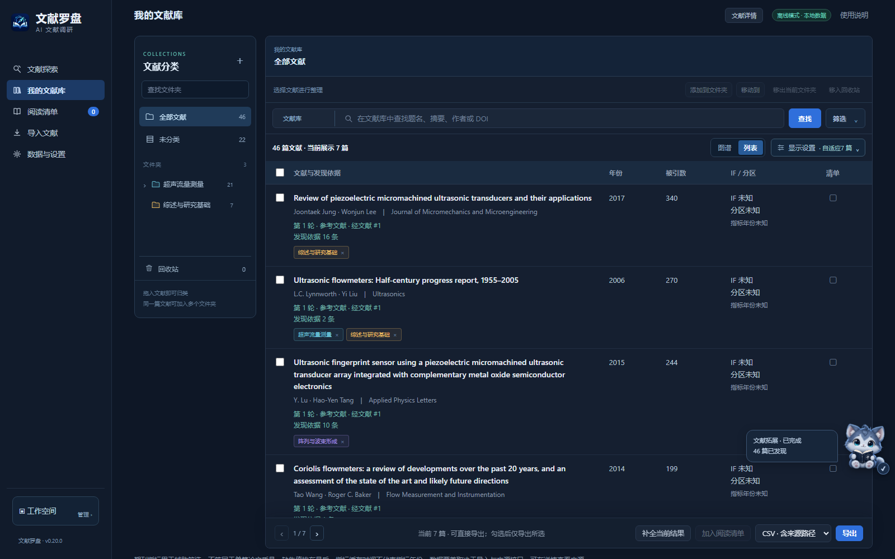

<div align="center">
  
  <h1>文献罗盘</h1>
  <p><strong>从已知论文出发，梳理研究脉络。</strong></p>
  <p>双向引文拓展 · AI 双语速览 · AI 全文解读</p>
</div>

文献罗盘是一款 AI 辅助的科研文献调研与阅读工具。从一篇已知论文出发，查找它引用的基础工作和引用它的后续研究，在图谱中查看论文之间的联系；再用 AI 翻译、概括和全文解读理解研究内容。选中的论文、分类目录和阅读备注可以保存，便于继续精读和撰写综述。

适用于开题前的文献检索、了解新的研究方向、比较相关工作和准备综述。


## 特色功能

- **双向引文追踪**：用已知论文查找研究基础与后续进展，在同一张图谱中查看引用关系，并按相关性、年份、被引数和期刊指标筛选。
- **AI 双语速览**：翻译题名、概括摘要，分别整理研究问题、方法、结果和贡献，帮助判断一篇论文是否值得精读。
- **AI 全文解读**：围绕文献原文，按章节梳理论证过程，解释研究方法、主要图表和结论，并返回原文页核对。
- **资料补全与阅读整理**：补充缺失的书目、期刊指标、中文译文与概括；将论文按研究方向分类，记录选文理由、待核对问题和读后要点。

## 启动软件

需要先安装 **Python 3.11 或更新版本**。下载并解压源码后：

1. Windows 用户双击 **`start.bat`**。首次运行会创建环境并安装依赖，请保持联网，等待安装完成。
2. 服务就绪后会自动打开软件页面；以后再次双击 `start.bat` 即可使用，无需手动输入本机网址。
3. 如需桌面入口，双击 **`create-shortcut.bat`** 创建“文献罗盘”快捷方式，以后从桌面图标启动。请保留源码所在文件夹，移动文件夹后重新创建快捷方式。

<details>
<summary>在终端启动（macOS、Linux 或手动安装）</summary>

```bash
python -m venv .venv
# Windows
.venv\Scripts\activate
# macOS / Linux
# source .venv/bin/activate
pip install -r requirements.txt
python launcher.py
```

启动器会显示实际可用的地址，并在服务就绪后打开浏览器。

</details>

启动后，先导入几篇已知论文，再选择种子开展引文拓展。对筛选出的论文查看 AI 速览或全文解读，将需要继续研究的论文加入阅读清单。

关闭网页后，后台服务仍会运行，方便重新打开页面。需要完全关闭时，点击 **工作空间 → 退出软件**。再次双击桌面“文献罗盘”图标或 `start.bat` 即可重新启动。

**工作空间**还可打开数据文件夹、迁移目录、打包备份和从备份导入。跨电脑使用时，在新电脑安装并启动软件，再导入备份；模型连接需重新配置。

## 配置 AI

打开 **数据与设置 → 模型连接**，选择服务，填写模型名称和 API 密钥，保存后点击 **测试连接**。可保存多组连接，随时切换、编辑或删除。

可连接 **DeepSeek、OpenAI** 等模型服务，也可自定义接入兼容 OpenAI 接口的服务。已有生成结果可以直接查看；新内容在点击生成后处理。密钥保存在用户数据目录，页面不回显。

## 文献库与阅读清单

**文献库**用于保存已经收集的论文。可按课题、研究方法或应用方向建立文件夹和子文件夹，把论文拖入目录；同一篇论文也可放进多个分类，便于从不同角度查找。

**阅读清单**用于挑选本轮需要阅读的论文。除了保留论文，还可以记录为什么选它、有哪些疑问、读后得到什么结论。它与文献库分别管理分类，两个工作区都支持回收站与误删恢复。

详细操作见[功能说明书](docs/USER_GUIDE.md)。



## 资料补全与双语速览

- **资料补全**：按篇或批量补充作者、年份、期刊等书目信息和可查询的期刊指标；有原始题名与摘要时，可用 AI 补充中文翻译和概括。已有人工整理会保留。
- **AI 速览**：把题名、摘要要点与研究问题、方法、结果、贡献分别展示，方便比较多篇论文；展开引用可查看原文依据。

## 全文解读：沿着原文理解一篇论文

关联文献原文后，AI 将内容整理成可以按目录阅读的中文解读，而不只是给出一段摘要：

- **研究概览**：说明论文研究什么、采用什么思路、取得哪些主要结果。
- **逐节导读**：沿论文的章节结构解释背景与问题、方法的作用、实验或分析过程，以及结果如何支持结论，帮助读者跟上作者的论证思路。
- **图表说明**：结合正文与图注，说明主要图表展示的内容、各子图的作用，以及它们支持的研究结论。可同时查看原文所在页，核对解读与图表是否一致。
- **结论与局限**：归纳论文报告的贡献与适用范围，梳理原文说明的限制，方便进一步比较不同研究。
- **原文核对与导出**：按页码打开引用依据，返回上下文查看；也可导出中文解读与相关图像，供后续阅读和整理。

原文可通过查找已有附件、下载公开全文或上传 PDF 关联。当前需要可提取文字的 PDF；扫描件需先完成 OCR。AI 解读应结合原文核对。

## 文献管理与导出

支持 CSV、RIS、GraphML 导出，以及 Zotero 授权同步；可选择目标集合，查看同步位置并迁移到其他集合。

## 许可

采用 [PolyForm Noncommercial License 1.0.0](LICENSE.md)，**仅限非商业用途**。商业使用需另行取得书面授权。第三方组件和论文资料遵循各自许可，详见[第三方声明](THIRD_PARTY_NOTICES.md)。
